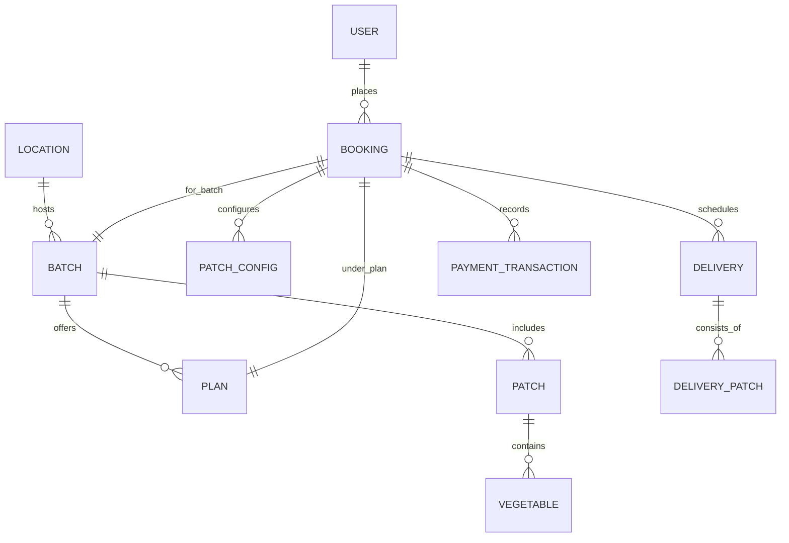

# Remote Farming Plan (RFP) — Backend API & Data Requirements Specification

**Version:** 1.0.0  
**Target Consumer:** Backend Engineering & API Team  
**Front-end Client:** Anaad Foods Flutter Mobile App (`features/rfp`)  
**Design Reference:** Google Stitch RFP UX Design Tokens (`stitch_remote_farming_plan_ui`)  
**Payment Integrations:** Mock Phase -> Production Easebuzz Gateway

---

## 1. Executive Summary & Domain Overview

The **Remote Farming Plan (RFP)** feature empowers Anaad Foods customers to reserve dedicated organic farm patches (P1, P2, P3, P4) across structured 12-week harvest seasons. Users customize their patch harvest (including/excluding specific seasonal vegetables, choosing harvest package weights, and delivery frequency), lock in reservations with a fractional booking deposit (e.g. ₹1,499), and receive weekly fresh farm harvest drops tracked in real-time.



---

## 2. Entity Models & Dictionaries

### 2.1 Location (`RfpLocation`)
| Field | Type | Required | Description | Example |
|---|---|---|---|---|
| `id` | String | Yes | Unique location / farm cluster ID | `"loc_01"` |
| `name` | String | Yes | Name of community or farm zone | `"Valley Sector 4"` |
| `pincode` | String | Yes | Postal code for delivery verification | `"122018"` |
| `sector` | String | Yes | Sector / Area name | `"Sector 4, Greenfield"` |
| `is_active` | Boolean | Yes | Service availability status | `true` |

### 2.2 Farming Batch (`RfpBatch`)
| Field | Type | Required | Description | Example |
|---|---|---|---|---|
| `id` | String | Yes | Unique batch identifier | `"batch_2026_01"` |
| `batch_number` | Integer | Yes | Display batch number | `12` |
| `start_date` | ISO 8601 | Yes | Start date of 12-week cycle | `"2026-10-01T00:00:00Z"` |
| `end_date` | ISO 8601 | Yes | End date of 12-week cycle | `"2026-12-23T00:00:00Z"` |
| `total_weeks` | Integer | Yes | Total cycle length (default 12) | `12` |
| `current_week` | Integer | Yes | Current active week index | `4` |
| `status` | String | Yes | Enum: `'active'`, `'upcoming'`, `'completed'` | `"active"` |
| `season_label` | String | No | Marketing tag for season | `"Rabi Autumn '26"` |
| `progress_percent`| Float | Yes | Growth progress (0.0 to 1.0) | `0.33` |

### 2.3 Subscription Plan (`RfpPlan`)
| Field | Type | Required | Description | Example |
|---|---|---|---|---|
| `id` | String | Yes | Unique plan identifier | `"plan_premium"` |
| `name` | String | Yes | Display name | `"Premium Organic"` |
| `tier` | String | Yes | Enum: `'standard'`, `'premium'` | `"premium"` |
| `description` | String | Yes | Tier highlights | `"Full access to all 4 patches..."` |
| `total_price` | Float | Yes | Final payable plan price (₹) | `14999.0` |
| `original_price` | Float | No | Crossed-out MRP (₹) | `17999.0` |
| `booking_amount`| Float | Yes | Advance booking deposit required (₹) | `1499.0` |
| `remaining_amount`| Float| Yes | Due on delivery commencement (₹) | `13500.0` |
| `discount_percent`| Float | No | Discount badge percentage | `16.0` |
| `badge` | String | No | Marketing chip | `"Best Value"` |
| `features` | Array[String]| Yes | Feature bullet points | `["Zero Chemical Pesticides", ...]` |

### 2.4 Patch (`RfpPatch`) & Vegetables (`RfpVegetable`)
| Field | Type | Required | Description | Example |
|---|---|---|---|---|
| `id` | String | Yes | Patch ID | `"p1"` |
| `label` | String | Yes | Display code | `"P1"` |
| `name` | String | Yes | Patch designation | `"Agricultural Box"` |
| `max_exclusions`| Integer | Yes | Max vegetables user can exclude | `3` |
| `available_weights`| Array[Float]| Yes | Available harvest weight choices in KG | `[2.5, 5.0, 7.5]` |
| `starting_price`| Float | Yes | Base patch pricing component (₹) | `3750.0` |
| `vegetables` | Array[Obj]| Yes | List of vegetables grown in patch | `[ { "id": "v1", "name": "Tomato", ... } ]` |

Vegetable Object:
- `id` (String): e.g. `"veg_tomato"`
- `name` (String): e.g. `"Country Heirloom Tomato"`
- `description` (String): e.g. `"Naturally vine-ripened, rich in lycopene"`
- `icon_name` (String, Optional): Flutter icon identifier
- `season` (String): e.g. `"Oct - Mar"`

### 2.5 Booking (`RfpBooking`)
| Field | Type | Required | Description | Example |
|---|---|---|---|---|
| `id` | String | Yes | Booking ID | `"rfp_bkg_908231"` |
| `batch_id` | String | Yes | ID of chosen batch | `"batch_2026_01"` |
| `batch_number` | Integer | Yes | Number of batch | `12` |
| `plan_id` | String | Yes | Selected plan ID | `"plan_premium"` |
| `plan_name` | String | Yes | Display name of plan | `"Premium Organic"` |
| `status` | String | Yes | Enum: `'reserved'`, `'active'`, `'completed'`, `'cancelled'` | `"active"` |
| `start_date` | ISO 8601 | Yes | Start date | `"2026-10-01T00:00:00Z"` |
| `end_date` | ISO 8601 | Yes | End date | `"2026-12-23T00:00:00Z"` |
| `patch_configs` | Array[Obj]| Yes | User's configured patches | `[ { "patch_id": "p1", ... } ]` |
| `total_amount` | Float | Yes | Total plan cost | `14999.0` |
| `booking_amount_paid` | Float | Yes | Deposit collected | `1499.0` |
| `remaining_amount` | Float | Yes | Amount pending | `13500.0` |
| `booked_at` | ISO 8601 | Yes | Booking timestamp | `"2026-09-21T07:00:00Z"` |
| `address` | Object | Yes | Shipping details | `{ "full_name": "Aarav Sharma", ... }` |

---

## 3. REST API Endpoints Specification

### 3.1 Locations & Onboarding

#### `GET /api/v1/rfp/locations`
Fetches all operational farm delivery zones.
- **Headers:** `Authorization: Bearer <token>`
- **Response (200 OK):**
```json
{
  "success": true,
  "data": [
    {
      "id": "loc_01",
      "name": "Valley Sector 4",
      "pincode": "122018",
      "sector": "Sector 4, Greenfield",
      "is_active": true
    },
    {
      "id": "loc_02",
      "name": "Green Valley Estate",
      "pincode": "122019",
      "sector": "Phase 2 Cluster",
      "is_active": true
    }
  ]
}
```

---

### 3.2 Batches & Plans

#### `GET /api/v1/rfp/batches?location_id=:locationId`
Returns active and upcoming farming cycles for the user's location.
- **Response (200 OK):**
```json
{
  "success": true,
  "data": [
    {
      "id": "batch_2026_01",
      "batch_number": 12,
      "start_date": "2026-10-01T00:00:00Z",
      "end_date": "2026-12-23T00:00:00Z",
      "total_weeks": 12,
      "current_week": 4,
      "status": "active",
      "season_label": "Autumn Harvest '26",
      "progress_percent": 0.33
    },
    {
      "id": "batch_2026_02",
      "batch_number": 13,
      "start_date": "2027-01-05T00:00:00Z",
      "end_date": "2027-03-30T00:00:00Z",
      "total_weeks": 12,
      "current_week": 0,
      "status": "upcoming",
      "season_label": "Spring Cycle '27",
      "progress_percent": 0.0
    }
  ]
}
```

#### `GET /api/v1/rfp/batches/:batchId/plans`
Returns the available subscription tiers.
- **Response (200 OK):**
```json
{
  "success": true,
  "data": [
    {
      "id": "plan_std",
      "name": "Standard Season",
      "tier": "standard",
      "description": "Essential organic staples across 2 dedicated patches.",
      "total_price": 11999.0,
      "original_price": 13999.0,
      "booking_amount": 1199.0,
      "remaining_amount": 10800.0,
      "discount_percent": 14.0,
      "badge": null,
      "features": ["2 Farm Patches", "Weekly 5 KG Delivery", "Organic Certified"]
    },
    {
      "id": "plan_prem",
      "name": "Premium Organic",
      "tier": "premium",
      "description": "Comprehensive farming experience across all patches with priority delivery.",
      "total_price": 14999.0,
      "original_price": 17999.0,
      "booking_amount": 1499.0,
      "remaining_amount": 13500.0,
      "discount_percent": 16.0,
      "badge": "Best Value",
      "features": ["All 4 Farm Patches", "Custom Vegetable Exclusions", "Up to 7.5 KG Yield", "Farm Visit Passes"]
    }
  ]
}
```

#### `GET /api/v1/rfp/batches/:batchId/patches`
Returns the 4 farm patches (P1, P2, P3, P4) and the vegetable catalogue for each.
- **Response (200 OK):**
```json
{
  "success": true,
  "data": [
    {
      "id": "p1",
      "label": "P1",
      "name": "Agricultural Box",
      "max_exclusions": 3,
      "available_weights": [2.5, 5.0, 7.5],
      "starting_price": 3750.0,
      "image_url": "https://cdn.anaadfoods.com/rfp/patches/p1.png",
      "vegetables": [
        {
          "id": "veg_tomato",
          "name": "Vine Tomato",
          "description": "Juicy organic heirloom tomatoes",
          "season": "Oct - Dec"
        },
        {
          "id": "veg_carrot",
          "name": "Red Carrots",
          "description": "Sweet winter Delhi carrots",
          "season": "Oct - Feb"
        }
      ]
    }
  ]
}
```

---

### 3.3 Dynamic Pricing Calculation

#### `POST /api/v1/rfp/pricing/calculate`
Calculates total price, discount deductions, booking deposit, and remaining balance according to selected plan and patch configurations.
- **Request Body:**
```json
{
  "batch_id": "batch_2026_01",
  "plan_id": "plan_prem",
  "patch_configs": [
    {
      "patch_id": "p1",
      "patch_label": "P1",
      "excluded_vegetable_ids": ["veg_radish"],
      "selected_weight": 5.0,
      "delivery_frequency": "twice_a_week"
    }
  ]
}
```
- **Response (200 OK):**
```json
{
  "success": true,
  "data": {
    "base_price": 17999.0,
    "discount_label": "Early Bird 16% Off",
    "discount_amount": 3000.0,
    "final_price": 14999.0,
    "booking_amount": 1499.0,
    "remaining_amount": 13500.0
  }
}
```

---

### 3.4 Booking & Checkout Flow

#### `POST /api/v1/rfp/bookings`
Reserves the farm patch subscription and generates booking ID for payment.
- **Request Body:**
```json
{
  "batch_id": "batch_2026_01",
  "plan_id": "plan_prem",
  "location_id": "loc_01",
  "patch_configs": [
    {
      "patch_id": "p1",
      "patch_label": "P1",
      "excluded_vegetable_ids": ["veg_radish"],
      "selected_weight": 5.0,
      "delivery_frequency": "once_a_week"
    }
  ],
  "payment_method": "easebuzz",
  "address": {
    "full_name": "Aarav Sharma",
    "address_line": "Villa 12B, Greenfield Expressway",
    "city": "Gurugram",
    "pincode": "122018",
    "phone": "+91 98765 43210"
  }
}
```
- **Response (201 Created):**
```json
{
  "success": true,
  "data": {
    "booking_id": "rfp_bkg_908231",
    "status": "reserved",
    "amount_to_pay": 1499.0,
    "currency": "INR",
    "payment_gateway": "easebuzz",
    "easebuzz_access_key": "ebz_acc_78a1bc8945",
    "booked_at": "2026-09-21T07:15:00Z"
  }
}
```

---

### 3.5 Customer Dashboard & Deliveries

#### `GET /api/v1/rfp/bookings/active`
Fetches the logged-in user's active RFP subscription.
- **Response (200 OK):**
```json
{
  "success": true,
  "data": {
    "id": "rfp_bkg_908231",
    "batch_id": "batch_2026_01",
    "batch_number": 12,
    "plan_id": "plan_prem",
    "plan_name": "Premium Organic",
    "status": "active",
    "start_date": "2026-10-01T00:00:00Z",
    "end_date": "2026-12-23T00:00:00Z",
    "total_amount": 14999.0,
    "booking_amount_paid": 1499.0,
    "remaining_amount": 13500.0,
    "booked_at": "2026-09-21T07:15:00Z",
    "address": {
      "full_name": "Aarav Sharma",
      "address_line": "Villa 12B, Greenfield Expressway",
      "city": "Gurugram",
      "pincode": "122018",
      "phone": "+91 98765 43210"
    },
    "patch_configs": [
      {
        "patch_id": "p1",
        "patch_label": "P1",
        "excluded_vegetable_ids": ["veg_radish"],
        "selected_weight": 5.0,
        "delivery_frequency": "once_a_week"
      }
    ]
  }
}
```

#### `GET /api/v1/rfp/bookings/:bookingId/schedule`
Returns the 12-week schedule of harvest drops.
- **Response (200 OK):**
```json
{
  "success": true,
  "data": [
    {
      "id": "del_01",
      "week_number": 1,
      "date": "2026-10-05T08:00:00Z",
      "day_of_week": "Monday",
      "status": "delivered",
      "description": "First Harvest Drop - Early Greens",
      "tracking_label": "Delivered at 09:30 AM",
      "patches": [
        {
          "patch_id": "p1",
          "patch_label": "P1",
          "weight_kg": 5.0,
          "included_vegetables": ["Tomato", "Spinach", "Carrot"]
        }
      ]
    },
    {
      "id": "del_02",
      "week_number": 2,
      "date": "2026-10-12T08:00:00Z",
      "day_of_week": "Monday",
      "status": "upcoming",
      "description": "Week 2 Harvest - Crop Progression",
      "tracking_label": "Scheduled for Morning Dispatch",
      "patches": [
        {
          "patch_id": "p1",
          "patch_label": "P1",
          "weight_kg": 5.0,
          "included_vegetables": ["Tomato", "Capsicum", "Beans"]
        }
      ]
    }
  ]
}
```

---

## 4. Easebuzz Payment Gateway Lifecycle

When ready to transition from mock checkout to live Easebuzz processing:

1. **Initiate Payment (`POST /api/v1/rfp/payments/easebuzz/initiate`):**
   - Backend calls Easebuzz API with `txnid`, `amount` (e.g. ₹1,499 for deposit or full amount), `productinfo` (`"RFP Batch #12 Booking"`), `firstname`, `email`, `phone`, `surl`, `furl`, and hash signature.
   - Returns `access_key` to Flutter client.
2. **Client Native Invocation:**
   - Flutter invokes Easebuzz SDK / payment bridge using `access_key`.
3. **Webhook Verification (`POST /api/v1/rfp/payments/easebuzz/webhook`):**
   - Easebuzz server invokes Anaad backend webhook with payload and response hash.
   - Backend verifies hash signature, transitions booking from `'reserved'` to `'active'`, and triggers notification.

---

## 5. Error Code Reference

| HTTP Code | Error Key | Client Handling |
|---|---|---|
| `400` | `EXCLUSIONS_LIMIT_EXCEEDED` | Client alerts user that patch max exclusions (e.g. 3) was exceeded. |
| `400` | `INVALID_BATCH_SELECTION` | Batch is full or closed for booking. |
| `404` | `LOCATION_UNAVAILABLE` | RFP not currently servicing specified pincode / city. |
| `409` | `PATCH_ALREADY_RESERVED` | Selected patch slot is occupied; prompt user to pick alternative. |
| `422` | `PAYMENT_VERIFICATION_FAILED` | Gateway reported payment failure; show retry CTA. |
